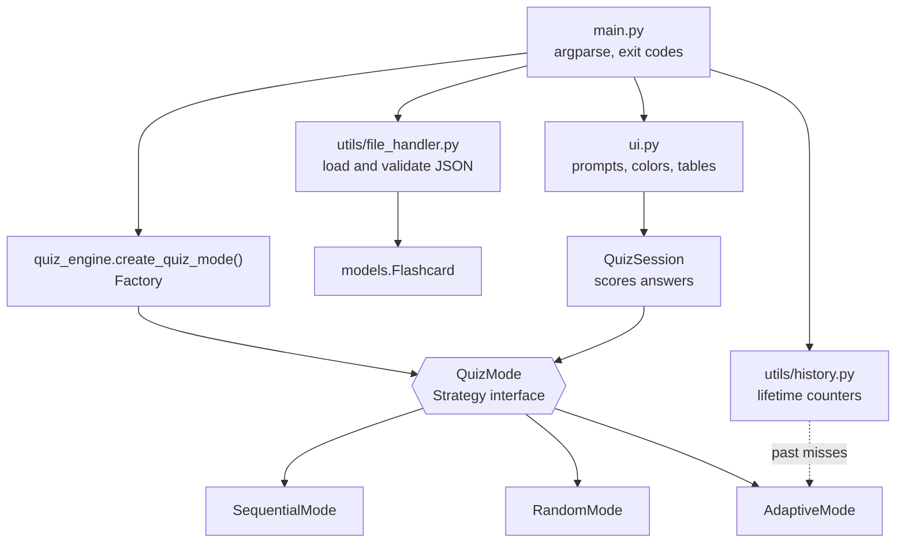

# Flashcard Quizzer

A command-line flashcard app. It loads a deck from a JSON file and asks the
questions in one of three modes: sequential, random or adaptive. Adaptive mode
remembers the cards you miss and asks them first next time.

The app was built with an AI coding agent (Claude Code) and reviewed at each
step. See [`docs/ai_edit_log.md`](docs/ai_edit_log.md) for the prompts, the
problems found and the changes, and [`docs/report.md`](docs/report.md) for
the final report.

## Features

- **Two deck formats:** a plain JSON array of cards, or an object with a
  `"cards"` array.
- **Strict validation:** a missing, malformed or wrong-shaped file gives one
  clear error line, never a Python traceback.
- **Three quiz modes**, built with the Strategy pattern and selected by a
  Factory:
  - `sequential`: cards in file order.
  - `random`: shuffled order (use `--seed` to repeat an order).
  - `adaptive`: a missed card comes back two questions later, and cards with
    more past misses come first.
- **Case-insensitive answers:** extra spaces are ignored too.
- **Colored feedback:** green for correct, red for incorrect. Colors turn off
  for pipes, files and `NO_COLOR`.
- **Session summary:** total questions, correct, incorrect, accuracy % and a
  list of missed terms.
- **Lifetime statistics (`--stats`):** per-card results over all sessions,
  weakest cards first.
- **Export missed cards (`--export-missed`):** saves the cards you missed as a
  new deck to practice.
- **Session limit (`--limit N`):** asks at most N questions.
- **Clean exit:** type `exit` or `quit`, or press Ctrl+C or Ctrl+D. Your score
  so far is still shown.
- **No runtime dependencies:** the app uses only the Python standard library.

## Requirements

- Python 3.10 or later
- `pip` and `venv` (included with Python)

## Installation

```bash
git clone https://github.com/FAbbas99/flashcard-quizzer.git
cd flashcard-quizzer
```

Create and activate a virtual environment:

```bash
python3 -m venv venv
source venv/bin/activate        # On Windows: venv\Scripts\activate
```

Install the development tools (pytest, black, flake8, isort, mypy):

```bash
python -m pip install -r requirements.txt
```

## Usage

Show all flags:

```bash
python main.py --help
```

Run a quiz in sequential mode:

```bash
python main.py --mode sequential --file data/glossary.json
```

Run an adaptive quiz and show lifetime statistics at the end:

```bash
python main.py -m adaptive -f data/python_basics.json --stats
```

Practice 5 random cards, then save the ones you missed:

```bash
python main.py -m random -f data/server_acronyms.json --limit 5 --export-missed missed.json
```

Quiz yourself again on only the missed cards:

```bash
python main.py -f missed.json
```

### All flags

| Flag | Description |
|------|-------------|
| `-f`, `--file PATH` | JSON deck to load (required) |
| `-m`, `--mode MODE` | `sequential` (default), `random` or `adaptive` |
| `--stats` | Show lifetime per-card statistics after the quiz |
| `-n`, `--limit N` | Ask at most N questions |
| `--export-missed PATH` | Save missed cards as a new deck |
| `--history PATH` | History file (default `.flashcard_history.json`) |
| `--no-history` | Do not read or write the history file |
| `--seed N` | Seed for random mode |
| `--no-color` | Plain text output |
| `-v`, `--verbose` | Show log messages |

### Example session

```text
$ python main.py -m sequential -f data/glossary.json --limit 3
Flashcard Quizzer - glossary (10 cards, sequential mode)
Type your answer and press Enter. Type "exit" to stop.

Q1: API
> application programming interface
Correct!

Q2: CDN
> content distribution network
Incorrect. The answer is: Content Delivery Network

Q3: CPU
> central processing unit
Correct!

Session Summary
Metric           Value
---------------  -----
Total Questions  3
Correct          2
Incorrect        1
Accuracy         66.7%

Missed terms
  - CDN: Content Delivery Network
```

## Deck format

Array format (`data/glossary.json`):

```json
[
  {"front": "API", "back": "Application Programming Interface"},
  {"front": "DNS", "back": "Domain Name System"}
]
```

Object format (`data/python_basics.json`):

```json
{
  "cards": [
    {"front": "Which keyword defines a function?", "back": "def"}
  ]
}
```

Each card needs a non-empty text `front` and `back`. Other keys are ignored.
The included decks are `glossary.json`, `python_basics.json` and
`server_acronyms.json`.

## Architecture



| Module | Responsibility |
|--------|----------------|
| `main.py` | Parses flags, connects the parts, maps errors to exit codes |
| `models.py` | The frozen `Flashcard` dataclass |
| `quiz_engine.py` | `QuizMode` strategies, the factory, `QuizSession`, `SessionStats` |
| `ui.py` | The question loop, colors and summary tables. No quiz logic |
| `utils/file_handler.py` | Reads and writes decks and the history file |
| `utils/history.py` | Pure functions that update and read the history counters |

To add a mode (for example spaced repetition), write a `QuizMode` subclass and
add one line to `MODE_REGISTRY` in `quiz_engine.py`. The factory and the CLI
choices update automatically.

## Development

Run the tests:

```bash
python -m pytest tests/
```

Run the tests with a coverage report (HTML output in `htmlcov/`):

```bash
python -m pytest --cov=. --cov-report=html
```

Check formatting, linting and types:

```bash
python -m black --check .
python -m flake8 .
python -m mypy .
```

Current results: 130 tests pass, 100% line coverage, and black, flake8, isort
and mypy (strict mode) report no errors. A copy of the coverage report is in
[`docs/coverage_report.txt`](docs/coverage_report.txt).

## Project structure

```text
.
├── main.py                  # CLI entry point
├── models.py                # Flashcard dataclass
├── quiz_engine.py           # Strategy modes, Factory, session scoring
├── ui.py                    # Terminal interface
├── utils/
│   ├── file_handler.py      # JSON deck and history I/O
│   └── history.py           # History counters
├── data/                    # Flashcard decks
├── tests/                   # pytest suite
├── docs/
│   ├── ai_edit_log.md       # AI interaction log
│   ├── report.md            # Final report
│   └── coverage_report.txt  # Coverage results
└── requirements.txt         # Development tools
```

## License

See [LICENSE.txt](LICENSE.txt).
